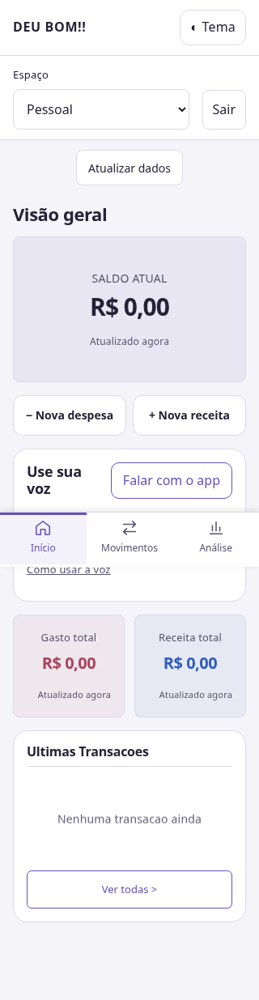
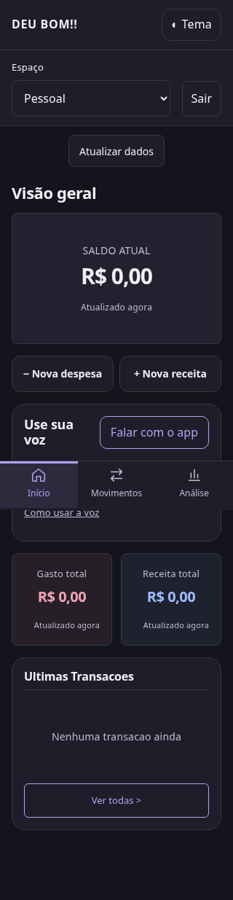

# DEU BOM!! — Finanças sem erro

Aplicação React/Vite para receitas, despesas e análise financeira. Esta versão substitui os dados de demonstração por autenticação e persistência no Supabase existente.

## Desenvolvimento

Requisitos: Node.js 24 (ver `.nvmrc`) e npm.

```sh
npm ci
cp .env.example .env.local
# Preencha a URL e a chave pública do projeto em .env.local.
npm run dev -- --host 0.0.0.0
```

Configure `VITE_SUPABASE_URL` e `VITE_SUPABASE_PUBLISHABLE_KEY`. A segunda aceita uma chave publishable (`sb_publishable_...`) ou a antiga chave `anon`. Ela é pública e integra o bundle. **Nunca use `service_role`, senha de banco ou chave secreta no frontend.** Não versione valores locais. Em um deploy Vite, as variáveis precisam existir durante o build, seguido de novo deploy quando alteradas. Configure ambas nas variáveis do repositório GitHub para o CI e também nas configurações do projeto Vercel que executa o build remoto. O workflow exige essas variáveis antes de um deploy de produção.

## Fluxos implementados

- Login com e-mail/senha, cadastro com confirmação quando exigida pelo projeto, restauração da sessão e logout.
- Seleção entre finanças pessoais e espaços existentes onde o usuário é proprietário ou membro aceito.
- Leitura paginada de categorias e transações; criação, exclusão confirmada e categorização em lote (até 100 itens).
- Formulários preservados quando a gravação falha; leituras com falha apresentam erro e nova tentativa, sem saldo zero fictício.
- Visualizadores não recebem controles de gravação; as permissões definitivas devem ser impostas por RLS no banco.
- Datas locais, filtros relativos ao calendário atual, totais calculados em centavos, exportação CSV com escape e proteção contra fórmulas em textos.
- Gráficos e exportação da análise usam as transações carregadas, sem percentuais ou dicas financeiros fixos de demonstração.

Dados pessoais usam `user_id = usuário autenticado AND workspace_id IS NULL`. Dados compartilhados usam somente o espaço explicitamente selecionado. A interface não combina esses escopos com OR. Nenhuma migração ou alteração automática de políticas é executada.

## Verificações

```sh
npm run lint
npm test
npm run build
npx playwright install chromium
npm run test:e2e -- --workers=2
npm run check:supabase
```

Em ambientes com diretório pessoal sem escrita, use `PLAYWRIGHT_BROWSERS_PATH=/workspace/.cache/ms-playwright` na instalação do Chromium e na execução dos testes. O verificador de banco requer Node 24 para respeitar o proxy do ambiente e usa somente GET com `limit=0`, sem solicitar registros.

Os testes de navegador usam exclusivamente uma API simulada em `supabase.test`, em desktop, celular e tela estreita de 320 px. Exercitam login, cadastro, persistência pela API simulada após recarga, categorização, exclusão, logout, exportação, filtros e estados de erro. Não criam contas nem lançamentos no banco real.

## Estado do Supabase e limites desta entrega

As 10 tabelas referenciadas pela exportação original responderam HTTP 200 às consultas das colunas descritas em `scripts/check-supabase.mjs`: `budgets`, `categories`, `event_items`, `event_participants`, `events`, `profiles`, `transactions`, `workspace_invitations`, `workspace_members`, `workspaces`.

Isso confirma disponibilidade na API, não constitui auditoria de RLS, constraints, triggers, funções ou permissões entre usuários. O endpoint administrativo de metadados não aceita a chave pública. As consultas somente de leitura de [docs/supabase-check.sql](docs/supabase-check.sql) devem ser executadas por acesso autorizado ao catálogo. Depois, valide login/cadastro e gravações com contas de teste, incluindo um proprietário, um editor, um visualizador e alguém sem acesso ao espaço. Verifique isolamento de SELECT/INSERT/UPDATE/DELETE, inclusive quando um usuário manipula diretamente as requisições.

Esta base ainda não implementa administração de espaços/convites, criação de categorias, orçamentos, eventos ou recorrência. Transações novas são simples e pendentes. O saldo representa a soma dos lançamentos carregados, incluindo pendentes; não é saldo bancário conciliado. O relatório desta entrega não afirma cobertura, Lighthouse ou prontidão de produção sem medição.

A `main` permanece preservada. O pull request deve ser revisado contra a base React `codex-publicar-repositorio-e-fluxos-reais`; não substitua a aplicação publicada antes da validação autenticada do projeto Supabase e da revisão das funcionalidades ainda ausentes.


## Aparência, voz e atualização

O controle **Tema**, sempre acessível, oferece Claro, Escuro e Sistema. A escolha é lembrada neste navegador e Sistema acompanha mudanças do dispositivo. A paleta usa violeta, azul e rosa suave, com receita/despesa diferenciadas também por texto. Os dois botões de novo lançamento começam com a mesma aparência; somente o tipo selecionado recebe destaque.

Na tela inicial, **Falar com o app** usa o reconhecimento pt-BR do navegador. “Gastei 35,90 reais no mercado” prepara um formulário editável; o app nunca salva uma transcrição automaticamente. “Tema claro”, “tema escuro” e “tema do sistema” mudam a aparência. Valores não reconhecidos devem ser preenchidos manualmente. O áudio pode ser processado pelo serviço do navegador; o microfone só inicia por ação explícita. Em navegadores sem suporte ou com permissão negada, os controles manuais continuam disponíveis. Os testes usam reconhecimento simulado; o funcionamento acústico em aparelhos físicos depende do navegador, permissões e serviço de voz.

Cada build inclui `version.json` com identificador derivado das fontes. O app verifica novas versões ao abrir, ao voltar ao foco e a cada minuto enquanto visível. O aviso permite adiar e pede confirmação antes de recarregar; formulários não são descartados automaticamente. O arquivo de versão é servido sem cache no Vercel. Não se trata de uma assinatura de notificações push.

Foram removidos atalhos duplicados para análise/transações, o seletor de tipo redundante e os rótulos decorativos repetidos da navegação. Há alvos de toque de pelo menos 44 px nos novos controles, respeito à área segura e ao movimento reduzido, e foco contido no formulário de lançamento.

### Prévia mobile

Capturas de navegador emulado de 320 px, com conta e API de teste, sem dados pessoais:

| Claro | Escuro |
| --- | --- |
|  |  |
